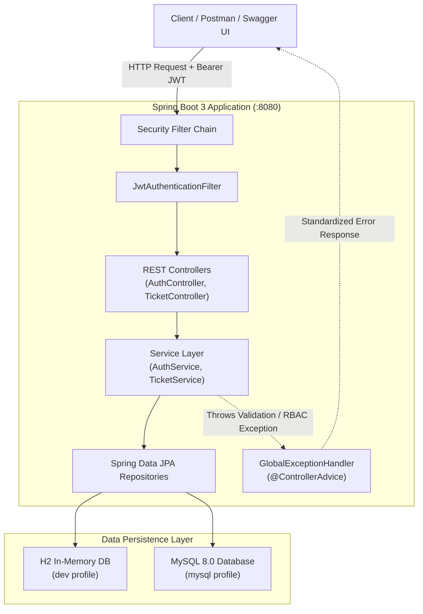

# 🏢 IT Service Desk Management System

[](https://it-service-desk-vy2j.onrender.com/swagger-ui/index.html)
[](https://github.com/vijaymuruganism-gif/it-service-desk/actions)
[](https://www.oracle.com/java/)
[](https://spring.io/projects/spring-boot)
[](https://spring.io/projects/spring-security)
[](https://jwt.io/)
[](https://www.mysql.com/)
[](https://www.docker.com/)
[](https://swagger.io/)
[](https://junit.org/junit5/)

> ### 🌐 Permanent 24/7 Live Cloud Deployment (Render.com)
> The backend application is actively deployed live on Render's cloud infrastructure:
> * **Interactive Swagger UI**: [https://it-service-desk-vy2j.onrender.com/swagger-ui/index.html](https://it-service-desk-vy2j.onrender.com/swagger-ui/index.html)
> * **System Health Endpoint**: [https://it-service-desk-vy2j.onrender.com/api/v1/health](https://it-service-desk-vy2j.onrender.com/api/v1/health)
> * **Pre-Seeded Test Accounts**:
>   * `admin` / `admin123` (`ROLE_ADMIN` — Full Administrative Access & Deletion)
>   * `john_support` / `engineer123` (`ROLE_SUPPORT_ENGINEER` — Triage & Comments)
>   * `alice_employee` / `employee123` (`ROLE_EMPLOYEE` — Ticket Creation & Tracking)

An enterprise-grade, role-based **IT Service Desk Management REST API** built with **Java 17** and **Spring Boot 3**. 

Designed to streamline technical support operations, internal incident reporting, ticket lifecycle triage, multi-tier engineer assignment, and real-time collaboration between organizational Employees, IT Support Engineers, and System Administrators.

---

## 🌟 Key Architecture & Capabilities

* **🔐 Stateless JWT Authentication**: Secure user registration and login with BCrypt password hashing and JSON Web Tokens (JJWT 0.12.5).
* **👥 Role-Based Access Control (RBAC)**: Multi-tenant role permissions (`ROLE_EMPLOYEE`, `ROLE_IT_SUPPORT`, `ROLE_ADMIN`) enforcing strict endpoint and business method-level access.
* **🎫 Ticket Lifecycle Management**: Full CRUD operations for service requests with priority levels (`LOW`, `MEDIUM`, `HIGH`, `CRITICAL`) and status state transitions (`OPEN` ➔ `IN_PROGRESS` ➔ `RESOLVED` ➔ `CLOSED`).
* **💬 Ticket Collaboration & Activity Notes**: Internal discussion threads and resolution activity logs attached to tickets with cascading audit preservation.
* **📖 Interactive Swagger / OpenAPI 3**: Built-in visual API documentation at `/swagger-ui/index.html` with direct JWT Bearer token authorization.
* **🧪 Automated Unit Testing**: Isolated service layer tests with **JUnit 5** and **Mockito** validating core business rules and custom exceptions.
* **🐳 Docker & Docker Compose**: Multi-stage `Dockerfile` (Eclipse Temurin 17 JRE) and unified `docker-compose.yml` linking backend with a health-checked MySQL 8 container.
* **⚡ Dual Database Profiles**:
  * `dev` (Default): Zero-config H2 in-memory database with interactive web console (`/h2-console`).
  * `mysql`: Production persistence with MySQL 8 and HikariCP connection pooling.

---

## 🏗️ System Architecture & Workflow



---

## 📂 Project Directory Structure

```text
it-service-desk/
├── .mvn/                                # Maven wrapper configuration
├── src/
│   ├── main/
│   │   ├── java/com/servicedesk/
│   │   │   ├── config/                  # SecurityConfig, JwtUtils, OpenApiConfig, DataInitializer
│   │   │   ├── controller/              # AuthController, TicketController, HealthCheckController
│   │   │   ├── dto/                     # Request and Response payload DTOs
│   │   │   ├── entity/                  # JPA Entities (User, Ticket, Category, Comment, Enums)
│   │   │   ├── exception/               # GlobalExceptionHandler and Custom Exceptions
│   │   │   ├── repository/              # Spring Data JPA interfaces
│   │   │   ├── service/                 # AuthService, TicketService, CustomUserDetailsService
│   │   │   └── ServiceDeskApplication.java # Spring Boot main entry point
│   │   └── resources/
│   │       ├── application.properties   # Base application configuration
│   │       ├── application-dev.properties   # H2 in-memory database configuration
│   │       └── application-mysql.properties # MySQL production configuration
│   └── test/
│       └── java/com/servicedesk/
│           ├── ServiceDeskApplicationTests.java # Context load integration test
│           └── TicketServiceTest.java           # JUnit 5 & Mockito service unit tests
├── .dockerignore                         # Docker build exclusion rules
├── docker-compose.yml                   # Multi-container orchestration (App + MySQL 8)
├── Dockerfile                           # Multi-stage production container build definition
├── mvnw / mvnw.cmd                      # Cross-platform Maven wrapper scripts
├── pom.xml                              # Maven build descriptor and dependencies
└── README.md                            # Comprehensive system documentation
```

---

## 👥 Seeded Default User Accounts

When running in `dev` mode or upon initial boot, the system pre-seeds test accounts with encrypted passwords:

| Username | Password | Role | Department | Description |
| :--- | :--- | :--- | :--- | :--- |
| `admin` | `admin123` | `ROLE_ADMIN` | IT Infrastructure | Full administrative privileges, user management, and ticket deletion |
| `john_support` | `engineer123` | `ROLE_SUPPORT_ENGINEER` | IT Service Desk | Can be assigned to tickets, triage status, and post resolution comments |
| `alice_employee` | `employee123` | `ROLE_EMPLOYEE` | Finance & Operations | Can raise tickets, view their own tickets, and post questions |

---

## 📡 REST API Reference

All protected endpoints require an `Authorization: Bearer <JWT_TOKEN>` header.

### 1. Authentication (`/api/v1/auth`)

| Method | Endpoint | Description | Permitted Roles |
| :--- | :--- | :--- | :--- |
| `POST` | `/api/v1/auth/register` | Register a new user account | Public |
| `POST` | `/api/v1/auth/login` | Authenticate user and obtain JWT token | Public |

### 2. Tickets Management (`/api/v1/tickets`)

| Method | Endpoint | Description | Permitted Roles |
| :--- | :--- | :--- | :--- |
| `POST` | `/api/v1/tickets` | Create a new service ticket | `EMPLOYEE`, `IT_SUPPORT`, `ADMIN` |
| `GET` | `/api/v1/tickets` | List all tickets (filtered by permissions) | `EMPLOYEE` (own only), `IT_SUPPORT`, `ADMIN` (all) |
| `GET` | `/api/v1/tickets/{id}` | Get ticket details by ID | Creator, Assigned Engineer, or `ADMIN` |
| `PUT` | `/api/v1/tickets/{id}/assign` | Assign ticket to an IT Support Engineer | `ADMIN`, `IT_SUPPORT` |
| `PUT` | `/api/v1/tickets/{id}/status` | Update ticket status (`IN_PROGRESS`, `RESOLVED`, etc.) | Assigned Engineer, `ADMIN` |
| `DELETE` | `/api/v1/tickets/{id}` | Delete a ticket and cascading comments | `ADMIN` only |

### 3. Ticket Collaboration & Comments (`/api/v1/tickets/{id}/comments`)

| Method | Endpoint | Description | Permitted Roles |
| :--- | :--- | :--- | :--- |
| `POST` | `/api/v1/tickets/{id}/comments` | Add a comment or resolution note to a ticket | Ticket stakeholders & `ADMIN` |
| `GET` | `/api/v1/tickets/{id}/comments` | Retrieve activity comments for a ticket | Ticket stakeholders & `ADMIN` |

### 4. System & Documentation

| Method | Endpoint | Description | Access |
| :--- | :--- | :--- | :--- |
| `GET` | `/api/v1/health` | System health and uptime status | Public |
| `GET` | `/swagger-ui/index.html` | Interactive Swagger API Explorer | Public |
| `GET` | `/v3/api-docs` | OpenAPI 3 JSON specification | Public |
| `GET` | `/h2-console` | H2 Web Console (when running `dev` profile) | Public |

---

## 🚀 Getting Started

### Prerequisites
* **Java 17 (LTS)** or higher
* (Optional) **Docker & Docker Compose** for containerized execution

---

### Option A: Local Run with H2 In-Memory Database (Fastest)

Zero external database installation required.

```powershell
# 1. Clone repository
git clone https://github.com/vijaymuruganism-gif/it-service-desk.git
cd it-service-desk

# 2. Run with Maven Wrapper
.\mvnw.cmd spring-boot:run
```

* **Swagger UI Documentation**: [http://localhost:8080/swagger-ui/index.html](http://localhost:8080/swagger-ui/index.html)
* **H2 Web Console**: [http://localhost:8080/h2-console](http://localhost:8080/h2-console) (JDBC URL: `jdbc:h2:mem:servicedeskdb`, Username: `sa`, Password: *(empty)*)

---

### Option B: Run via Docker Compose (Spring Boot + MySQL 8)

Run the complete production-style multi-container stack with a single command:

```powershell
docker compose up --build -d
```

This will automatically:
1. Spin up a **MySQL 8.0** container with persistent storage and healthchecks.
2. Build the Spring Boot container via multi-stage `Dockerfile`.
3. Wait for MySQL to become healthy, connect via internal bridge network, and run migrations.
4. Expose the API on port `8080`.

To stop the containers:
```powershell
docker compose down
```

---

## 🧪 Running Automated Tests

Run the complete JUnit 5 and Mockito test suite:

```powershell
.\mvnw.cmd test
```

Expected Output:
```text
[INFO] Running com.servicedesk.TicketServiceTest
[INFO] Tests run: 5, Failures: 0, Errors: 0, Skipped: 0
[INFO] Running com.servicedesk.ServiceDeskApplicationTests
[INFO] Tests run: 1, Failures: 0, Errors: 0, Skipped: 0
[INFO] BUILD SUCCESS
```

---

## 📅 7-Day Engineering Roadmap Summary

* **Day 1**: Architecture design, initial Spring Boot 3 setup, Health Check endpoint, Git baseline.
* **Day 2**: JPA Domain Entities (`User`, `Ticket`, `Category`, `Comment`), Multi-profile database setup (`dev` H2 + `mysql`), and automatic data seeding.
* **Day 3**: DTOs with Jakarta Validation, Service Layer implementation, RESTful Ticket APIs, and centralized Global Exception Handling (`@ControllerAdvice`).
* **Day 4**: Spring Security 6 stateless architecture, JWT Authentication filter (`JwtUtils`), user registration, and login tokens.
* **Day 5**: Role-Based Access Control (RBAC), ticket assignment rules, comment discussions, and resolution audit trails.
* **Day 6**: Interactive Swagger / OpenAPI 3 UI integration with JWT Bearer scheme and automated unit testing suite with JUnit 5 & Mockito.
* **Day 7**: Production Docker containerization (`Dockerfile`, `docker-compose.yml`), MySQL 8 orchestration, and comprehensive documentation.

---

## 📄 License
This project is licensed under the MIT License.
